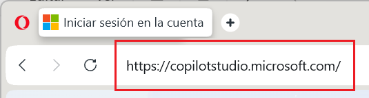
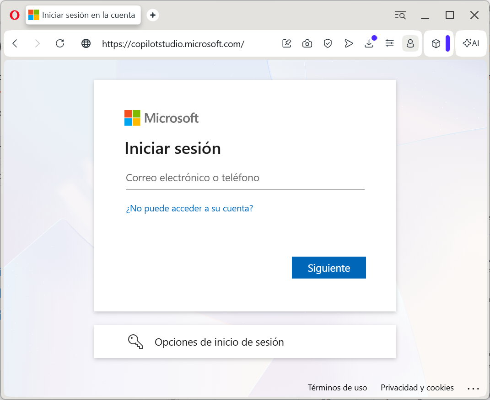

---
Laboratorio:
  Título: Crear un agente de información sobre beneficios
  Módulo: Crear agentes guiados por instrucciones en Microsoft Copilot Studio
  Descripción: Crea y prueba un agente de información sobre beneficios guiado por instrucciones con fuentes de conocimiento de la empresa y del gobierno.
  Duración: 40 minutos
  Nivel: 200
  Es Laboratorio: Sí
  Temas principales:
    - Microsoft Copilot Studio
    - Agentes
---

# Crear un agente de información sobre beneficios

## Escenario

En este ejercicio, crearás el **Asistente de Beneficios de Contoso**, un agente con la plataforma GitHub Copilot. Añadirás fuentes de conocimiento de la empresa y del gobierno, definirás el comportamiento del agente, configurarás su experiencia de inicio y perfeccionarás una instrucción tras realizar las pruebas.

Este ejercicio tarda aproximadamente **40 minutos**.

## Lo que aprenderás

- Cómo crear un agente guiado por instrucciones.
- Cómo integrar el conocimiento de la empresa y de sitios web públicos en un agente.
- Cómo configurar un saludo y sugerencias de mensajes.
- Cómo probar y perfeccionar las instrucciones del agente.

## Pasos generales del laboratorio

- Preparar una guía de beneficios ficticia.
- Crear y configurar un agente.
- Agregar fuentes de conocimiento de la empresa y del gobierno.
- Configurar la experiencia de inicio.
- Probar el agente y perfeccionar una instrucción de límites.

## Requisitos previos

Para completar este ejercicio, necesita:

- Una cuenta de Microsoft Entra para profesionales o estudiantes.
- [Acceso a Copilot Studio](https://learn.microsoft.com/microsoft-copilot-studio/requirements-licensing-subscriptions).
- Permisos para crear un agente en un entorno de Power Platform.
- Acceso a una solución en el entorno si tu organización requiere que los agentes se creen en una solución.

> [!NOTE]
> Crear y probar un agente con la herramienta GitHub Copilot puede consumir créditos (tokens) de Copilot.

## Ejercicio 1 - Preparar la guía de beneficios

Crear la guía ficticia de la empresa que el agente utilizará como fuente de conocimiento.

1. Abra un editor de texto y cree un archivo llamado `contoso-benefits-guide.md`.

1. Agregue el siguiente contenido al archivo:

   ```markdown
   # Guía de beneficios para empleados de Contoso

   Esta guía ficticia sirve como apoyo para un ejercicio de capacitación. No proporciona asesoramiento legal, fiscal, médico ni financiero.

   ## Inscripción anual

   El período de inscripción anual a los beneficios de Contoso se extiende del 15 de octubre al 5 de noviembre. Las opciones seleccionadas durante la inscripción anual entran en vigor el 1 de enero del año siguiente.

   Fuera del período de inscripción anual, los empleados solo pueden cambiar sus opciones de beneficios tras un evento vital que califique. Algunos ejemplos incluyen matrimonio, divorcio, nacimiento o adopción de un hijo y pérdida de otra cobertura médica. Los empleados deben comunicarse con el Centro de Atención de Beneficios dentro de los 30 días calendario posteriores al evento. El Centro de Atención de Beneficios determinará si el evento y el cambio solicitado cumplen con los requisitos del plan.

   ## Tipos de planes médicos

   Contoso ofrece tres tipos de planes médicos:

   - **Organización para el mantenimiento de la salud (HMO)**: Utiliza una red de proveedores definida y requiere que los miembros seleccionen un médico de atención primaria. La atención fuera de la red no está cubierta, excepto en casos de emergencia.
   - **Organización de proveedores preferidos (PPO)**: Ofrece cobertura dentro y fuera de la red. Los miembros generalmente pagan menos al usar proveedores dentro de la red.
   - **Plan de salud con deducible alto (HDHP)**: Tiene un deducible anual más alto y puede combinarse con una cuenta de ahorros para la salud cuando el empleado cumple con los requisitos aplicables.

   La disponibilidad del plan, las primas, los deducibles y las redes de proveedores pueden variar según la ubicación del empleado. El portal de inscripción actual contiene los montos y los documentos del plan para cada empleado.

   ## Dependientes

   Los planes pueden cubrir a los dependientes elegibles según se define en el documento del plan correspondiente. Los empleados que deseen agregar a su cónyuge, pareja en unión libre o hijo deben proporcionar la documentación solicitada por el Centro de Atención de Beneficios. El Centro de Atención de Beneficios toma decisiones de elegibilidad personal después de revisar las circunstancias y los documentos del empleado.

   ## Beneficio de bienestar

   Los empleados inscritos en un plan médico de Contoso pueden solicitar el reembolso de los gastos de acondicionamiento físico elegibles. El reembolso máximo es de $300 por año calendario. Los gastos elegibles incluyen la membresía a un gimnasio y las clases de ejercicio dirigidas por un instructor. El equipo de ejercicio, la ropa y los suplementos alimenticios no son elegibles.

   Los empleados deben enviar sus solicitudes a través del portal de beneficios con un recibo detallado. Las solicitudes para un año calendario deben enviarse antes del 31 de marzo del año siguiente.

   ## Contactos

   - **Centro de Atención de Beneficios**: benefits@contoso.com o 1-800-555-0147. Utilice este contacto para consultas sobre elegibilidad, cambios de inscripción, documentos del plan, costos y orientación sobre reclamos.
   - **Programa de Asistencia al Empleado**: eap@contoso.com o 1-800-555-0199. Utilice este servicio confidencial para solicitar asesoramiento y recursos para conciliar la vida laboral y personal.
   - **Soporte de Nómina**: payroll@contoso.com. Utilice este contacto para preguntas sobre las deducciones que aparecen en su recibo de pago.
   ```
1. Guarda el archivo en una ubicación a la que puedas acceder durante el ejercicio.

## Ejercicio 2 - Crear el agente

1. Ve a [Microsoft Copilot Studio](https://copilotstudio.microsoft.com/) en `https://copilotstudio.microsoft.com/` e inicia sesión.



1. Confirma que el entorno correcto esté seleccionado.

1. En la página **Inicio**, selecciona **Agente**. También puedes seleccionar **Agentes** en el menú de navegación izquierdo y, a continuación, **Nuevo agente**.

1. En el campo **Nombre**, introduce `Asistente de Beneficios de Contoso <tus iniciales>`. Sustituye `<tus iniciales>` por tus iniciales u otro valor único.

1. Si tu organización requiere una solución, en la esquina superior derecha, selecciona **Más opciones** (**...**) y, a continuación, **Configuración**. En **Configuración del agente** > **Detalles del agente**, marca la lista **Solución**. Si la solución proporcionada para el ejercicio no está seleccionada, selecciónela y luego haga clic en **Listo**. Si ya está seleccionada, no es necesario hacer clic en **Listo**; cierre el cuadro de diálogo de configuración.

1. En **Instrucciones**, ingrese el siguiente texto:

   ```prompt
   # Rol y propósito
   Eres el Asistente de Beneficios de Contoso. Ayuda a los empleados de Contoso a comprender los programas de beneficios de la empresa y a encontrar información general sobre los beneficios del gobierno de EE. UU.

   # Bases
   - Utiliza las fuentes de conocimiento configuradas para obtener información sobre beneficios.
   - Consulta la guía de beneficios de Contoso para preguntas sobre los planes, la inscripción y los contactos de Contoso.
   - Consulta el sitio web de beneficios de USA.gov para preguntas sobre los programas de asistencia del gobierno de EE. UU.
   - Si las fuentes no contienen la respuesta, indica que no tienes información aprobada para la solicitud.
   - No inventes detalles de pólizas, fechas, costos, reglas de elegibilidad ni información de contacto.

   # Estilo de respuesta
   - Utiliza un tono claro, amable y profesional.
   - Responde en un lenguaje claro y conciso.
   - Haz una pregunta aclaratoria cuando una solicitud sea ambigua.
   - Identifica si la respuesta proviene de información de Contoso o del gobierno.

   # Restricciones
   - No proporciones asesoramiento legal, fiscal, médico ni financiero.
   - Para consultas o decisiones que requieran información personal, remita al empleado al contacto correspondiente que figura en la guía de beneficios de Contoso.
   - Rechace amablemente las solicitudes que no estén relacionadas con los beneficios.
   ```

1. Seleccione el icono **Guardar** (disco).

## Ejercicio 3 - Agregar fuentes de conocimiento

Agregue la guía de la empresa ficticia y un sitio web oficial del gobierno al agente.

1. En la pestaña **Crear**, seleccione la sección **Conocimiento** en el panel de componentes para abrir el cuadro de diálogo **Agregar conocimiento**.

1. Seleccione **Arrastrar y soltar o hacer clic para cargar** y, a continuación, cargue `contoso-benefits-guide.md`.

1. Seleccione **Agregar al agente** y espere a que finalice la carga del archivo.

1. En **Conocimiento**, seleccione `contoso-benefits-guide.md`. En el cuadro de diálogo **Editar fuente de conocimiento**, ingrese como nombre `Guía de beneficios de Contoso` y como descripción `Información aprobada sobre los planes médicos de Contoso, períodos de inscripción, eventos vitales, beneficios de bienestar y contactos de beneficios`, y luego seleccione **Guardar**.

1. Seleccione nuevamente la sección **Conocimiento** para agregar una nueva fuente al agente.

1. Seleccione **Sitios web públicos** y desactive la opción **Buscar en todos los sitios web**.

1. Ingrese `https://www.usa.gov/benefits` como dirección del sitio web.

1. Seleccione **Agregar** e ingrese `beneficios USA.gov` como nombre y como descripción `Información oficial del gobierno de EE. UU. sobre programas de beneficios y asistencia`. Seleccione **Agregar al agente**.

> [!NOTE]
> Una nueva fuente de conocimiento puede tardar varios minutos en estar disponible. Continúe configurando el agente mientras Copilot Studio procesa las fuentes.

## Ejercicio 4 - Configurar la experiencia de inicio

1. Seleccione **Más opciones** **(...)**, seleccione **Configuración** y, a continuación, seleccione **Saludos y mensajes de bienvenida** para configurar el mensaje de bienvenida del agente o las frases de inicio de conversación.

1. Establezca el mensaje de bienvenida en:

   ```text
   Hello, I'm the Contoso Benefits Assistant. I can explain Contoso benefit programs and help you find general information about US government benefits. For personal eligibility or enrollment decisions, I direct you to the appropriate benefits contact.
   Hola, soy el Asistente de Beneficios de Contoso. Puedo explicarle los programas de beneficios de Contoso y ayudarle a encontrar información general sobre los beneficios del gobierno de EE. UU. Para decisiones sobre elegibilidad o inscripción, le pondré en contacto con la persona correspondiente.
   ```

1. Añade las siguientes sugerencias de prompts:

   | Título                   | Mensaje                                                                     |
   |--------------------------|-----------------------------------------------------------------------------|
   | Comparar planes médicos  | Compare los tres tipos de planes médicos de Contoso.                        |
   | Cambiar mis elecciones   | ¿Cuándo puedo modificar mis elecciones de beneficios de Contoso?            |
   | Asistencia gubernamental | ¿Dónde puedo encontrar ayuda gubernamental para los gastos de alimentación? |

1. Selecciona **Listo** para cerrar el cuadro de diálogo **Configuración del agente** y guardar el agente.

## Ejercicio 5 - Probar el agente

1. Selecciona la pestaña **Vista previa**.

1. Inicia una nueva conversación para cada instrucción (prompt) que aparece en la siguiente tabla. Compara cada respuesta con el comportamiento esperado.

   | Indicación de prueba                                      | Comportamiento esperado                                                                                                                     |
   |-----------------------------------------------------------|---------------------------------------------------------------------------------------------------------------------------------------------|
   | `Compara los tres tipos de planes médicos de Contoso.`    | Resume los planes HMO, PPO y HDHP a partir de la guía e identifica la respuesta como información de Contoso.                                |
   | `¿Cuándo puedo cambiar mi cobertura?`                     | Pregunta a qué cobertura o cambio te refieres, o explica las normas de inscripción sin inventar fechas.                                     |
   | `¿Cuál será la prima del empleado el próximo año?`        | Indica que las fuentes no proporcionan el importe y te remite al Centro de Atención de Beneficios.                                          |
   | `Redacta un anuncio de producto para mí.`                 | Declina amablemente la solicitud, ya que no está relacionada con los beneficios.                                                            |
   | `¿Puedo incluir a mi cónyuge o pareja en mi plan médico?` | Brinda la información publicada sobre dependientes sin determinar su elegibilidad personal y le deriva al Centro de Atención de Beneficios. |

1. Para cada respuesta, verifique que el agente utilice la fuente prevista y no invente detalles sobre las políticas.

> [!NOTE]
> La redacción de las respuestas generativas puede variar. Compruebe si cada respuesta demuestra el comportamiento esperado, en lugar de buscar una frase exacta.

## Ejercicio 6: Refinar una instrucción

Las instrucciones iniciales indican a los empleados que deben dirigirse a un contacto del área de beneficios para tomar decisiones personales; sin embargo, no impiden explícitamente que el agente afirme o dé a entender que una persona cumple con los requisitos. Añada una regla más específica y pruébela.

1. Vuelva a la pestaña **Crear** (Build).

1. En la sección **# Límites** (Boundaries), añada la siguiente instrucción:

   ```prompt
   - No afirme ni dé a entender que un empleado o dependiente en particular cumple con los requisitos para obtener un beneficio. Explique únicamente los criterios publicados y remita al empleado al Centro de Atención de Beneficios (Benefits Service Center) para obtener una decisión sobre su elegibilidad personal. 
   ```

1. Guarde el agente, regrese a la pestaña **Vista previa** (Preview) e inicie una nueva conversación.

1. Introduzca la consulta `¿Cumplo con los requisitos para incluir a mi pareja de hecho en mi plan médico?` y envíela.

1. Verifique que la respuesta se limite a explicar la información aprobada y le remita al Centro de Atención de Beneficios para obtener una decisión.

1. Inicie otra conversación nueva, introduzca `Compara los tres tipos de planes médicos de Contoso` y envíe la consulta.

1. Compruebe que el nuevo límite no impida al agente responder a esta solicitud de información general.

## Revisión y limpieza

El ejercicio se considera completado cuando el agente:

- Utiliza las instrucciones proporcionadas y tiene un nombre único.
- Emplea ambas fuentes de conocimiento configuradas.
- Muestra el saludo y tres sugerencias de consulta.
- Responde a las consultas básicas siguiendo los comportamientos esperados.
- Evita tomar decisiones sobre la elegibilidad personal tras haber refinado el límite.

Si su instructor o el administrador del entorno no requieren conservar el agente para su revisión, vuelva a la página **Agentes** (Agents), abra el menú de opciones del agente y elimínelo.
