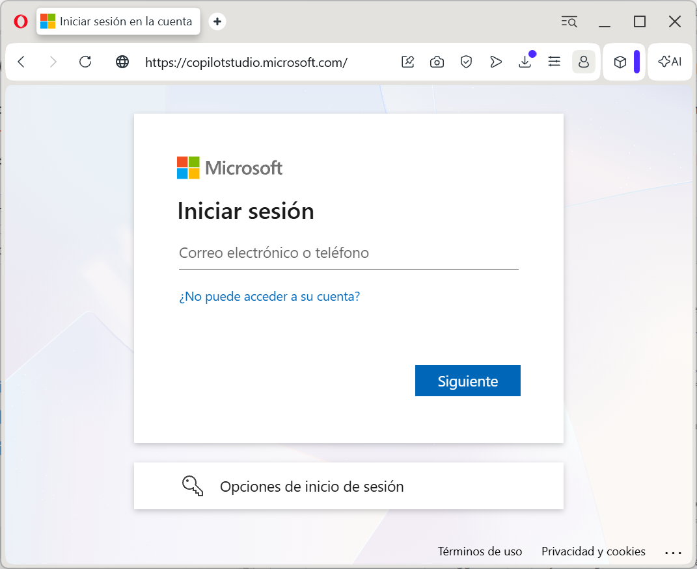
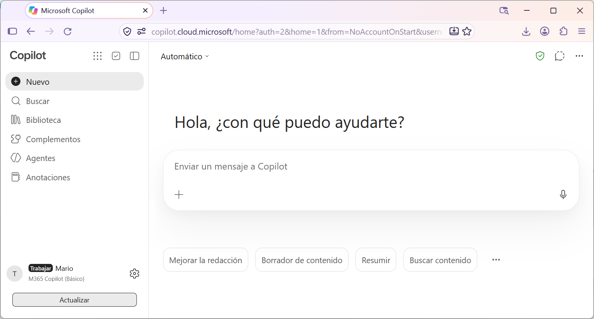

---
Laboratorio:
 Título: Crear un agente de recomendación de equipamiento
 Módulo: Fundamentar y ampliar agentes con conocimientos, herramientas y habilidades (Skills)
 Descripción: Crear un agente que utilice conocimientos sobre políticas, el inventario actual de SharePoint y una habilidad (skill) proporcionada para recomendar equipamiento para el entorno de trabajo. 
 Duración: 50 minutos
 Nivel: 200
 Es Laboratorio: Sí
 Temas principales:
    - Microsoft Copilot Studio
    - Agentes
---

# Crear un agente de recomendación de equipos

## Escenario

En este ejercicio, creará el **Asesor de equipos de Contoso** (Contoso Equipment Advisor), un agente basado en la infraestructura de GitHub Copilot. Creará una pequeña lista de inventario en SharePoint, incorporará una política de equipos como base de conocimiento, configurará un conector de SharePoint, cargará una habilidad (skill) de recomendación proporcionada y refinará la descripción de dicha habilidad (skill) tras realizar pruebas.

Completar este ejercicio le llevará aproximadamente **50 minutos**.

## Lo que aprenderá

- Cómo añadir y validar políticas como base de conocimiento.
- Cómo configurar un conector de SharePoint para acceder a datos actualizados.
- Cómo añadir una habilidad (skill) proporcionada a un agente.
- Cómo refinar la descripción de una habilidad (skill) basándose en los resultados de las pruebas.

## Pasos generales del laboratorio

- Crear un inventario de equipos en SharePoint.
- Preparar una política de equipos y la habilidad (skill) proporcionada.
- Crear y configurar un agente.
- Añadir la política como base de conocimiento y configurar una herramienta de inventario.
- Añadir, probar y refinar la habilidad (skill) proporcionada.

## Requisitos previos

Para completar este ejercicio, necesita:

- Una cuenta de Microsoft Entra para profesionales o estudiantes.
- [Acceso a Copilot Studio](https://learn.microsoft.com/microsoft-copilot-studio/requirements-licensing-subscriptions).

- Permisos para crear un agente en un entorno de Power Platform.
- Acceso a un sitio de SharePoint donde pueda crear una lista y utilizar el conector de SharePoint.
- Acceso a una solución en el entorno si tu organización requiere que los agentes se creen en una solución.

> [!NOTE]
> Crear y probar un agente con la herramienta GitHub Copilot puede consumir créditos (tokens) de Copilot.

## Ejercicio 1 - Crear el inventario de equipos

Cree un origen de datos independiente para este ejercicio.

> [!NOTE]
> Si no dispone de un sitio de SharePoint, cree uno antes de continuar:
> 1. Acceda a [Microsoft Copilot](https://copilot.cloud.microsoft/) en `https://copilot.cloud.microsoft` e inicie sesión con sus credenciales de laboratorio.

> 2. Seleccione el icono del iniciador de aplicaciones **(⋮⋮⋮)** y, a continuación, elija **SharePoint**. Si no lo ve, seleccione **Más aplicaciones**.
> 3. En el menú de navegación de la izquierda, seleccione **Crear** (Build) y, después, elija **Sitio** > **Sitio de equipo**.
> 4. Si se le solicita elegir una plantilla, seleccione **Equipo estándar** (Standard team) y, a continuación, haga clic en **Usar plantilla**.
> 5. Introduzca `PL7008 Equipamiento <sus iniciales>` como nombre del sitio; sustituya `<sus iniciales>` por un valor único.
> 6. Asegúrese de que la **Configuración de privacidad** esté establecida en **Privado: solo los miembros pueden acceder a este sitio**; deje el resto de la configuración con sus valores predeterminados y seleccione **Crear sitio**.
> 7. Si se le solicita añadir miembros, puede omitir este paso y seleccionar **Ir al sitio**. Espere a que se abra el nuevo sitio.

1. Abra el sitio de SharePoint que utiliza para el ejercicio y, a continuación, seleccione **Nuevo** > **Lista**. En **Crear desde cero**, seleccione **Lista**.

1. Introduzca `PL7008 Inventario de equipos <sus iniciales>` como nombre de la lista (sustituyendo `<sus iniciales>` por un valor único) y, después, seleccione **Crear** (Create).

1. Mantenga la columna **Título** predeterminada. Seleccione **+ Agregar columna** y cree las siguientes columnas:

   | Nombre de la columna | Tipo                      | 
   |----------------------|---------------------------| 
   | Category             | Una línea de texto        | 
   | BestFor              | Múltiples líneas de texto |
   | Location             | Una línea de texto        | 
   | UnitPrice            | Moneda                    | 
   | UnitsAvailable       | Número                    | 
   | AccessibilityNotes   | Múltiples líneas de texto |

1. Seleccione **+ Nuevo** y añada los siguientes elementos a la lista:

   | Título                 | Categoría | BestFor                                         | Ubicación | Precio Unitario | Unidades disponibles | Notas sobre accesibilidad                                                          |
   |------------------------|-----------|-------------------------------------------------|---------- |---------------: |--------------------: |--------------------------------------------------------------------------------------------|
   | Contoso Standard 14    | Laptop    | Productividad general y trabajo híbrido         | Seattle   | 950             | 12                   | Admite teclado externo, ratón y dos pantallas                                              |
   | Contoso Performance 15 | Laptop    | Análisis de datos y desarrollo local            | Seattle   | 1450            | 4                    | Admite teclado externo, ratón y tres pantallas                                             |
   | Contoso Travel 13      | Laptop    | Viajes frecuentes y presentaciones              | Chicago   | 1100            | 0                    | Chasis ligero y una pantalla externa                                                       |
   | Contoso Focus 27       | Monitor   | Productividad general y trabajo con documentos  | Seattle   | 320             | 8                    | Soporte de altura ajustable y modo de baja emisión de luz azul                             | 
   | Contoso Wide 34        | Monitor   | Hojas de cálculo grandes y análisis en paralelo | Seattle   | 680             | 2                    | Soporte de altura ajustable; compruebe el ancho del escritorio antes de realizar el pedido |

1. Copie la dirección del sitio de SharePoint y anote el nombre exacto de la lista. Utilizará ambos valores al configurar la herramienta de conexión (connector). Por ejemplo, la dirección de un sitio podría ser `https://contoso.sharepoint.com/sites/sitename`.

## Ejercicio 2 - Preparar la política de equipamiento

1. Abra un editor de texto y cree un archivo llamado `contoso-equipment-policy.md`.

1. Añada el siguiente contenido al archivo:

   ```markdown
   # Política de equipamiento de Contoso

   Esta política ficticia sirve de apoyo para un ejercicio de formación. 

   ## Reglas generales

   Recomiende únicamente equipos que estén disponibles actualmente en el lugar de trabajo del empleado. Una recomendación no implica la reserva ni el pedido de un artículo. Si no hay ningún artículo adecuado disponible, indique que no hay existencias que cumplan los requisitos y remita al empleado al equipo de adquisiciones de TI. 

   Antes de realizar una recomendación definitiva, pregunte por el puesto del empleado, su lugar de trabajo, su escenario laboral principal y sus necesidades de accesibilidad. No asuma la existencia de una necesidad de accesibilidad si no se ha expresado explícitamente. 

   ## Estándares para portátiles

   - Para puestos de productividad general y puestos híbridos, se utiliza un portátil estándar, siempre que haya disponibilidad. 
   - Los analistas de datos y los desarrolladores pueden utilizar un portátil de alto rendimiento cuando su trabajo implique el procesamiento local de datos, el uso de herramientas de desarrollo o el manejo de modelos de gran tamaño. 
   - Los empleados que viajan con frecuencia pueden utilizar un portátil para viajes, siempre que haya disponibilidad en su ubicación. 

   ## Estándares para monitores

   - Los puestos de productividad general pueden utilizar un monitor de 27 pulgadas. 
   - Los puestos de análisis de datos pueden utilizar un monitor ultra ancho (ultrawide) cuando el empleado trabaje habitualmente con hojas de cálculo extensas o conjuntos de datos dispuestos uno al lado del otro. 
   - Antes de recomendar un monitor ultra ancho (ultrawide), verifique el ancho del escritorio. 

   ## Accesibilidad y excepciones

   Explique las características de accesibilidad pertinentes disponibles en el inventario, sin determinar por su cuenta si satisfacen las necesidades específicas de cada persona. Las solicitudes relacionadas con evaluaciones ergonómicas, tecnología de asistencia, excepciones a la política o equipos no incluidos en la lista deben dirigirse al equipo de adquisiciones de TI a través de la dirección de correo electrónico it-procurement@contoso.com. 
   ```
1. Guarde el archivo en una ubicación a la que pueda acceder durante el ejercicio.

## Ejercicio 3 - Preparar la habilidad (skill) proporcionada

1. Cree otro archivo llamado `equipment-recommendation.md`.

1. Añada al archivo el siguiente contenido de la habilidad (skill) proporcionada:

   ```markdown
   ---
   name: equipment-recommendation
   description: Se utiliza cuando un usuario solicita una recomendación sobre un equipo portátil o un monitor. 
   ---

   # Recomendación de equipamiento

   Ayude al usuario a seleccionar equipamiento aprobado por Contoso, sin realizar ningún pedido.

   ## Datos de entrada requeridos

   Antes de ofrecer una recomendación definitiva, recopile la siguiente información:

   - Puesto o rol del empleado.
   - Ubicación de trabajo.
   - Escenario de trabajo principal.
   - Requisitos de accesibilidad, si los hubiera.

   Solicite únicamente la información que no esté ya disponible en la conversación.

   ## Pasos

   1. Utilice la fuente de conocimiento sobre la política de equipamiento de Contoso para identificar las normas aplicables.
   2. Utilice la herramienta de obtención de inventario de equipamiento (*Get equipment inventory*) para consultar el inventario actual.
   3. Considere únicamente los artículos disponibles en la ubicación del empleado que tengan un valor de `UnitsAvailable` **(unidades disponibles)** superior a cero. 
   4. Compare los artículos aptos con el puesto del empleado, su escenario de trabajo y los requisitos indicados.
   5. Recomiende un artículo para cada categoría solicitada y explique por qué es adecuado.

   ## Reglas de decisión

   - No recomiende artículos que no estén en existencia (stock).
   - No dé a entender que una recomendación implica reservar o solicitar el equipamiento.
   - No deduzca necesidades de accesibilidad ni decida por su cuenta si una característica satisface las necesidades de una persona en particular.
   - Si no hay ningún artículo que cumpla los requisitos, indíquelo y proporcione el contacto del departamento de adquisiciones de TI (IT procurement) que figura en la política.

   ## Criterios de éxito

   Una respuesta completa debe hacer referencia a la política, reflejar el inventario actual, explicar por qué el artículo es adecuado e identificar cualquier información faltante o la necesidad de escalar la consulta. 
   ```

1. Guarde el archivo en la misma ubicación que el archivo `contoso-equipment-policy.md`, de modo que pueda acceder a ambos durante el ejercicio.

## Ejercicio 4: Crear el agente



1. Accede a [Microsoft Copilot Studio](https://copilotstudio.microsoft.com/) en `https://copilotstudio.microsoft.com/` e inicia sesión.

1. Confirma que el entorno seleccionado sea el correcto.

1. En la página de **Inicio**, selecciona **Agente**. Alternativamente, selecciona **Agentes** en el menú de navegación de la izquierda y, a continuación, selecciona **Nuevo agente**.

1. En el campo **Nombre**, introduce `Contoso Equipment Advisor <tus iniciales>`.

1. Si tu organización requiere una solución, selecciona **Más opciones** (**...**) en la esquina superior derecha y, después, elige **Configuración**. En **Configuración del agente** > **Detalles del agente**, revisa la lista **Solución**. Si la solución proporcionada para el ejercicio no está seleccionada, elígela y haz clic en **Listo**. Si ya está seleccionada, no es necesario hacer clic en **Listo**; simplemente cierra el cuadro de diálogo de configuración.

1. En **Instrucciones**, introduce el siguiente texto:

   ```prompt
   Eres el Contoso Equipment Advisor (Asesor de Equipamiento de Contoso). Ayuda a los empleados a comprender las normas sobre equipamiento e identifica el equipo disponible actualmente. 

   Utiliza el conocimiento configurado para las políticas de Contoso. Emplea las herramientas disponibles para consultar el inventario actual. Cita la fuente utilizada para cada declaración de política. No inventes información sobre equipamiento, disponibilidad, precios, excepciones a las políticas o estado de los pedidos. 

   Mantén un tono conciso y profesional. Solicita cualquier información faltante antes de ofrecer una recomendación definitiva. Para evaluaciones ergonómicas, tecnología de asistencia, excepciones a las políticas o equipamiento no listado, remite al empleado al equipo de adquisiciones de TI. 

   No realices, prometas ni sugieras la creación de un pedido. Declina amablemente cualquier solicitud que no esté relacionada con el equipamiento del entorno laboral. 
   ```

1. Selecciona **Guardar**.

## Ejercicio 5 - Agregar fuente de conocimiento sobre políticas

1. En la pestaña **Crear** (Build), seleccione la sección **Conocimiento** (Knowledge) en el panel de componentes para abrir el cuadro de diálogo **Agregar conocimiento** (Add knowledge).

1. Seleccione **Arrastrar y soltar o hacer clic para cargar** (Drag and drop or click to upload) y, a continuación, cargue el archivo `contoso-equipment-policy.md`.

1. Seleccione **Agregar al agente** (Add to agent) y espere a que finalice la carga.

1. En la sección **Conocimiento** (Knowledge), seleccione `contoso-equipment-policy.md`. En el cuadro de diálogo **Editar fuente de conocimiento** (Edit knowledge source), introduzca `Contoso equipment policy` como nombre y `Estándares de equipamiento aprobados según el rol, el escenario de trabajo, la ubicación y las necesidades de accesibilidad. Esta fuente no contiene información sobre el inventario actual ni los niveles de existencias` como descripción.

1. Seleccione **Guardar** (Save) para aplicar los cambios a la fuente de conocimiento.

## Ejercicio 6: Agregar la herramienta de conector de inventario

1. En la pestaña **Crear** (Build), seleccione la sección **Herramientas** (Tools) para abrir el cuadro de diálogo **Agregar una herramienta** (Add a tool).

1. Seleccione **Conectores** (Connectors), busque `SharePoint` y, debajo de **SharePoint**, seleccione **Ver (x) más** (See (x) more) para expandir la lista de acciones disponibles.

1. Seleccione la acción **Obtener elementos** (Get items) y, a continuación, seleccione **+ Agregar** (+ Add) para crear su conexión con SharePoint.

1. En la sección **Herramientas** (Tools), seleccione el conector de SharePoint recién agregado. En **Detalles de la herramienta** (Tool details), asigne a la herramienta el nombre `Get equipment inventory`. En **Descripción para la IA** (Description for AI), introduzca `Recupera el inventario actual de equipamiento de Contoso, incluyendo categoría, ubicación, precio, unidades disponibles, uso previsto y notas sobre accesibilidad. Úselo para consultas sobre disponibilidad de equipamiento y recomendaciones. Esta herramienta lee el inventario; no realiza reservas ni pedidos de artículos.`

1. En la sección **Entradas** (Inputs), seleccione **Personalizado** (Custom) junto a cada entrada y configure los valores de la siguiente manera:

   | Entrada             | Valor                                           |
   |---------------------|------------------------------------------------ |
   | Dirección del sitio | La dirección del sitio de SharePoint que copió. |
   | Nombre de la lista  | `PL7008 Equipment Inventory <sus iniciales>`    |

1. Deje sin cambios el resto de las entradas opcionales. La lista es deliberadamente pequeña, de modo que la herramienta pueda devolver todos los elementos de ejercicio para que el agente los compare.

1. Mantén el comportamiento de finalización que permite al agente utilizar los resultados de la herramienta para generar una respuesta contextual. Selecciona **Listo** y, a continuación, selecciona **Guardar**.

> [!NOTE]
> Los campos del conector pueden variar según la versión del mismo. Si la acción muestra parámetros de entrada obligatorios adicionales, configúralos de manera que la acción devuelva todos los elementos de la lista de ejercicios.

## Exercise 7 - Test knowledge and the tool

1. Select the **Preview** tab.

1. Start a new conversation by entering `What is the equipment rule for a data analyst who works with large spreadsheets?` and submit it.

1. Verify that the response uses and cites the policy. It should explain the performance laptop and ultrawide monitor rules without claiming that either item is available.

1. Start a new conversation, enter `Which laptops are currently available in Seattle?` and submit it.

1. If prompted, select **Approve** to grant the agent permission to use SharePoint. You may need to grant permission more than once.

1. Verify that the agent uses the **Get equipment inventory** tool and reports only laptops with available units in Seattle.

1. Start a new conversation, enter `Which travel laptop can I get in Chicago?` and submit it.

1. Verify that the agent reports that no travel laptops are currently available in Chicago and doesn't recommend the out-of-stock travel laptop.

## Exercise 8 - Add and test the supplied skill

1. Return to the **Build** tab and select the **Skills** section in the components panel.

1. Select **Upload a skill**, upload `equipment-recommendation.md`, and confirm that the skill appears under **Skills**.

1. Select the **Preview** tab, start a new conversation, enter `Recommend a laptop for a data analyst in Seattle who runs local data models. I don't have any accessibility requirements` and submit it.

1. Verify that the skill guides the agent to consult the policy, retrieve inventory, and recommend the available performance laptop with an explanation.

1. Start a new conversation, enter `Help me outfit a new data analyst's home office in Seattle for large spreadsheets. There are no accessibility requirements` and submit it.

1. Inspect the activity details. The skill's initial description mentions only a laptop or monitor recommendation, so the broader setup request might not activate it or might produce an incomplete result.

> [!NOTE]
> Generative behavior can vary. If the skill activates and produces a complete result, use `Plan an approved equipment setup for a new analyst in Seattle` as the broader activation test.

## Ejercicio 9 - Refinar la descripción de la habilidad (skill)

1. Abra el archivo `equipment-recommendation.md` en un editor de texto (Bloc de Notas, Notepad++, MarkDown++).

1. En la sección de metadatos, al principio del archivo, reemplaza el valor de `descripción` por:

   ```yaml
   Descripción: Úsala cuando un usuario solicite una recomendación de equipamiento de trabajo aprobado, compare equipos para un puesto o escenario laboral, o planifique la configuración de un equipo portátil, un monitor o un entorno de trabajo completo.
   ```

1. Guarde el archivo.

1. Seleccione la pestaña **Crear** (Build). En la sección **Habilidades** (Skills) del agente, abra la habilidad (skill) cargada, selecciona **(...)** > **Reemplazar** (Replace) y sustitúyela por el archivo actualizado. Si la opción de reemplazar no está disponible, elimina la habilidad (skill) original y carga el archivo actualizado.

1. Regrese a la pestaña **Vista previa** (Preview), inicie una nueva conversación y vuelve a introducir la solicitud sobre la configuración de un espacio de trabajo en casa.

1. Verifique que el agente recopile la información faltante, utilice la política y la herramienta de inventario de equipos (*Get equipment inventory*), recomiende únicamente elementos disponibles y explique por qué cada elemento es adecuado.

1. Inicie otra conversación nueva, introduce la pregunta `¿Cómo horneo una hogaza de pan?` y envíala.

1. Verifique que la habilidad (skill) relacionada con el equipamiento no se active y que el agente indique que dicha solicitud, al no estar relacionada, queda fuera de su ámbito de actuación.

## Revisión y limpieza

El ejercicio se considera completado cuando el agente:

- Utiliza las instrucciones proporcionadas y cuenta con un nombre único.
- Emplea la política de equipamiento como base de conocimiento e incluye referencias.
- Utiliza la herramienta de conexión con SharePoint para consultar el inventario actual.
- No recomienda equipos que no estén disponibles (sin existencias).
- Utiliza la habilidad (skill) proporcionada para configurar un entorno de trabajo completo, tras haber refinado su descripción.
- No activa dicha habilidad (skill) ante una solicitud que no esté relacionada con el tema.

Si su instructor o el responsable del entorno no requieren conservar los recursos para su revisión, elimina el agente y la lista de SharePoint que creaste para este ejercicio.
